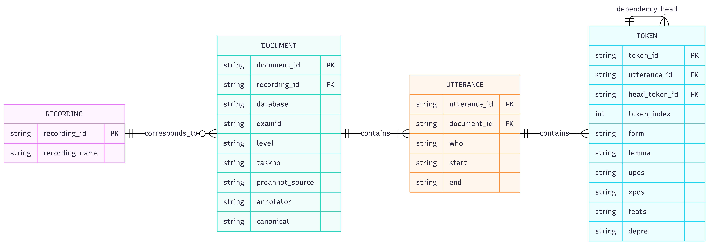

# Databáze mluvených projevů v češtině jako cizím jazyce (státní občanství v ČR): technická dokumentace

## a) Základní údaje

**Název výsledku:** Databáze mluvených projevů v češtině jako cizím jazyce (státní občanství v ČR)

**Typ výsledku:** S – specializovaná veřejná databáze

**Vlastník výsledku:** Univerzita Karlova

**Tvůrce a správce databáze:** Ústav formální a aplikované lingvistiky, Matematicko-fyzikální fakulta, Univerzita Karlova.

**Uživatelé databáze:** Široká veřejnost, vědecká a odborná komunita, pedagogové a studenti, zejména zájemci o češtinu jako cizí jazyk a o výzkum osvojování češtiny nerodilými mluvčími.

**Umístění databáze:** Databáze je integrována do systému TEITOK (<http://teitok.corpuswiki.org/>), který je provozován na platformě LINDAT/CLARIAH-CZ (<https://lindat.cz/>).

**Veřejná adresa databáze:** <http://hdl.handle.net/11346/H4WT>

## b) Cíl výsledku

Cílem databáze je zpřístupnit autentické mluvené projevy nerodilých mluvčích češtiny na jazykové úrovni B1 podle Společného evropského referenčního rámce pro jazyky (SERR), která je požadována pro udělení státního občanství v České republice. Databáze obsahuje nahrávky zachycující ústní část Certifikované zkoušky z češtiny pro cizince na úrovni B1 (<https://ujop.cuni.cz/cce>). Nahrávky zahrnují dialogy mezi zkoušejícím (rodilým mluvčím) a kandidátem zkoušky (nerodilým mluvčím). Nahrávky jsou opatřeny manuálními přepisy a bohatou lingvistickou anotací.

Databáze vznikla v rámci projektu realizovaného v Ústavu formální a aplikované lingvistiky Matematicko-fyzikální fakulty Univerzity Karlovy. Její vytvoření navazuje na předchozí výzkum projektu zaměřený na jazykové rysy, které umožňují rozlišovat jednotlivé jazykové úrovně mluvených projevů nerodilých mluvčích češtiny.

Při tvorbě databáze byly provedeny zejména následující činnosti: sběr audionahrávek, jejich anonymizace, tvorba a revize manuálních přepisů, identifikace jednotlivých mluvčích, časové zarovnání přepisů s nahrávkami, automatická lingvistická anotace a příprava strukturovaných dat pro zveřejnění v prostředí TEITOK.

Rozsah prací na výsledku: 0,8 FTE

Databáze je zveřejněna jako specializovaná veřejná databáze a je volně a bezplatně dostupná široké veřejnosti. Je určena zejména k dalšímu lingvistickému výzkumu, výzkumu osvojování češtiny jako cizího jazyka, vývoji a testování metod automatického zpracování mluvené řeči a výukovým účelům. Data mohou sloužit také jako podklad pro experimenty strojového učení zaměřené na automatické hodnocení jazykové úrovně mluvených projevů.

## c) Architektura údajů

### Základní popis databáze a rozsah dat

Databáze obsahuje audionahrávky ústní části Certifikované zkoušky z češtiny pro cizince na úrovni B1 a jejich manuální přepisy ve formátu TEITOK (XML). Jednotlivé soubory TEITOK jsou propojeny s odpovídajícími audionahrávkami ve formátu MP3.

Poskytovatel nahrávek (Ústav jazykové a odborné přípravy Univerzity Karlovy, ÚJOP UK, https://ujop.cuni.cz/UJOP-1.html) povolil ke zveřejnění pouze vybrané úlohy. Databáze proto obsahuje pouze ty části nahrávek, jejichž zveřejnění bylo poskytovatelem povoleno.

**Rozsah databáze.** Základní statistiky databáze jsou shrnuty v následujícím přehledu:

- Počet audionahrávek: 65
- Celková délka nahrávek v databázi: 4h 51m 48s
- Počet souborů s manuálními přepisy: 65
- Počet tokenů: 29,572
- Počet replik: 3,348
- Jazyk: čeština
- Jazyková úroveň: B1 podle SERR

### Struktura databáze

Databáze sestáva s nasledujících entit a vazeb mezi nima:

1. **Recording (Nahrávka)** – Představuje původní zvukový záznam. Ke každé nahrávce může teoreticky existovat více přepisů (v této databázi je to 1:1).
2. **Document (Dokument)** – Odpovídá jednotlivému transkriptu ve formátu TEITOK (XML). Obsahuje metadata o zkoušce (úroveň CEFR, ID zkoušky, úkol, hodnotitel atd.) a je spojen s nahrávkou.
3. **Utterance (Replika)** – Jednotlivé repliky uvnitř dokumentu. Obsahují informaci o mluvčím (who) a časových značkách (start, end).
4. **Token (Slovo)** – Základní lingvistická jednotka (slovo). Obsahuje tvar (form), lemma, slovní druhy (upos, xpos), morfologické rysy a syntaktickou závislost (deprel).
    - *Rekurzivní vazba:* Token může odkazovat sám na sebe (head_token_id), což tvoří stromovou strukturu závislostního syntaktického popisu.

**Grafické znázornění struktury databáze.** Nasledující E-R diagram blíže znázorňuje výše popsanou strukturu databáze:

**Struktura souborů TEITOK.** Základním stavebním kamenem, z nějž je sestavená databáze, jsou soubory reprezentující transkripty ve formátu TEITOK. Formát TEITOK je formát XML, který odpovídá standardu Text Encoding Initiative (TEI; <https://www.tei-c.org/>), avšak s mírně odlišným přístupem k tokenizaci. Struktura TEITOK souborů v naší databázi je následující:

**Hlavička s metadaty \<teiHeader\>.** Hlavička souboru TEITOK se skládá z následujících částí:

1. **\<fileDesc\> – Popis souboru**
    - **\<titleStmt\>:** Obsahuje název souboru a informace o autorech a anotátorech.
    - **\<editionStmt\>:** Obsahuje číslo verze.
    - **\<publicationStmt\>:** Publikační detaily, jako je vydavatel, datum vydání a licence.
    - **\<sourceDesc\>:** Popis zdrojové nahrávky a odkaz na ni.
2. **\<encodingDesc\> – Popis kódování**
    - **\<projectDesc\>:** Stručný popis projektu, v rámci něhož data vznikla.
    - **\<annotationDecl\>:** Detaily o jednotlivých krocích anotace (primární, revize, lingvistická anotace).
3. **\<profileDesc\> – Profil textu**
    - **\<langUsage\>:** Použitý jazyk (čeština).
    - **\<textClass\>:** Metadata dokumentu:
      - database: Název databáze.
      - exam-id: Identifikátor zkoušky.
      - cefr-level: Úroveň podle SERR. Tato databáze obsahuje výhradně nahrávky zkoušek úrovně B1.
      - task-number: Číslo úlohy.
      - preannot-source: Zdroj předběžné anotace.
      - annotator: Kód anotátora.
      - canonical: Hodnota 1 značí kanonický přepis.

**Hlavní obsah \<text\>.** Sekce \<text\> obsahuje jednotlivé úseky mluveného projevu strukturované pomocí elementů \<u\>:

- **\<u\>:** Každý element reprezentuje úsek projevu a má atributy:
  - start a end: Počáteční a koncový čas v sekundách.
  - who: Mluvčí (např. EXAM_1 pro zkoušejícího a CAND_1 pro kandidáta).
- **\<s\>:** Každá věta je označena elementem \<s\>.
- **\<tok\>:** Elementy tokenů, jejichž atributy popisují lemma, slovní druh, morfologické rysy a syntaktický vztah.
- **\<anon/\>:** Anonymizovaný úsek nahrávky.
- **\<gap reason="unintelligible"/\>:** Nesrozumitelný úsek nahrávky.

**Anotace tokenu v elementu \<tok\>.** Element \<tok\> reprezentuje token, jenž většinou odpovída slovu. Každý token je dále popsán nasledujícími atributy, které odpovídají standardům z projektu Universal Dependencies (https://universaldependencies.org/guidelines.html):

- **ord**: poradové číslo tokenu ve větě
- **lemma**: základní tvar slova
- **upos**: značka univerzálního slovního druhu
- **xpos**: originální morfologická značka
- **feats**: morfologické vlastnosti
- **head**: odkaz na rodičovský token
- **deprel**: typ závislostního syntaktického vztahu k rodiči

**Úplnost záznamů a metadat.** Jednotlivé záznamy obsahují odpovídající audionahrávku a její manuální přepis. Přepisy obsahují identifikaci mluvčích (zkoušející vs. kandidát zkoušky) a časové značky jednotlivých replik. Součástí přepisů je rovněž automatická lingvistická anotace. Uvedené údaje obsahují všechny záznamy v databázi.

Rozsah zveřejněných nahrávek je dán souhlasem poskytovatele dat, který povolil zveřejnění pouze vybraných úloh. Zveřejněné nahrávky proto nemusí obsahovat původní záznam celého průběhu zkoušky.

## d) Práce s údaji (třídění, filtrování, vyhledávání atd.)

Databáze umožňuje následující funkce:

- Prohlížení audionahrávek a jejich manuálních přepisů.
- Zobrazení jednotlivých replik a identifikace mluvčích.
- Přehrávání nahrávek a synchronizované prohlížení přepisů.
- Zobrazení časových značek začátku a konce jednotlivých replik.
- Zobrazení automatické lingvistické anotace jednotlivých tokenů:
  - slovní druh (PoS),
  - morfologický tag,
  - podrobné morfologické příznaky (Features),
  - lemma (základní tvar slova).
- Zobrazení automatické syntaktické analýzy ve formě závislostního stromu.
- Vyhledávání pomocí jazyka CQL.
- Sestavování vyhledávacích dotazů prostřednictvím grafického rozhraní Query Builder.
- Zobrazování výsledků vyhledávání v přehledné podobě.
- Export výsledků vyhledávání ve formátu XML.

Podrobný návod k používání jednotlivých funkcí a příklady vyhledávání jsou uvedeny v samostatné uživatelské příručce.

## e) Použité softwarové nástroje

Databáze je veřejně dostupná prostřednictvím platformy LINDAT/CLARIAH-CZ a systému TEITOK. Přístup k ní je bezplatný a nevyžaduje registraci.

Samotná data z databáze jsou rovněž uloženy v certifikovaném repozitáři LINDAT/CLARIAH-CZ, jenž zabezpečuje bezpečné uložiště s pravidelným zálohovaním a persistentními identifikátory.

Pro přípravu a zpracování dat a anotací jsme použili další nástroje, které popisujeme níže.

### TEITOK

[TEITOK](http://teitok.corpuswiki.org/) je framework pro vytváření, správu a zveřejňování anotovaných korpusů. Umožňuje veškerou práci s databází. Jeho webové rozhraní je implementováno v kombinaci jazyků PHP a JavaScript.

Pro náš projekt, který kombinuje nahrávky mluveného projevu a jejich přepisy, je stěžejní funkcionalita prostředí TEITOK, která umožňuje vytvářet, zobrazovat a upravovat přepisy nahrávek (<http://www.teitok.org/index.php?action=help&id=wavesurfer>).

K práci se samotnou nahrávkou TEITOK využívá JavaScriptovou knihovnu [WaveSurfer.js](http://wavesurfer-js.org/).

**Uložení dat.** Data korpusu jsou v prostředí TEITOK primárně uložena ve formě souborů. V tomto případě se jedná o nahrávky ve formátu MP3, hlavní části jsou však soubory ve formátu TEITOK, které obsahují všechny přepisy a anotace včetně metadat. Tyto soubory jsou navzájem provázány s odpovídajícími nahrávkami.

Kromě toho jsou data z databáze uloženy v certifikovaném repozitáři LINDAT/CLARIAH-CZ (viz níže), který zabezpečuje bezpečné uložiště s pravidelným zálohovaním a persistentními identifikátory.

**Dotazování, vyhledávání a filtrování.** Rychlé dotazování, vyhledávání a filtrace jsou umožněny integrovaným [procesorem dotazů CQP](https://cwb.sourceforge.io/files/CQP_Manual.pdf), klíčovou komponentou sady nástrojů [IMS Open Corpus Workbench (CWB)](https://cwb.sourceforge.io/).

CQP převádí korpusy ve formátu XML do binární podoby a efektivně je indexuje.

Dotazování v indexovaných korpusech probíhá pomocí jazyka [CQL](https://www.cambridge.org/sketch/help/userguides/CQL%20Help%201.3.pdf), který je standardem v korpusové lingvistice.

TEITOK také nabízí Query Builder, v němž může uživatel specifikovat dotaz vyplněním formuláře. Výsledek dotazu vrácený z CQP je následně zpracován pomocí TEITOKu a zobrazen uživateli v přehledné formě. Výsledky dotazů je možné stáhnout ve formátu XML.

### Repozitář LINDAT/CLARIAH-CZ

Kromě výše uvedeného jsou data z databáze uložena v certifikovaném repozitáři LINDAT/CLARIAH-CZ (<https://lindat.mff.cuni.cz/repository/>), který provozuje Ústav formální a aplikované lingvistiky Matematicko-fyzikální fakulty Univerzity Karlovy (ÚFAL MFF UK). Repozitář je primárně součástí velké výzkumné infrastruktury LINDAT/CLARIAH-CZ a zároveň je součástí Národní repozitářové platformy (NRP), což je česká implementace evropského cloudu pro otevřenou vědu EOSC (European Open Science Cloud). Je postaven na softwaru CLARIN-DSpace, který patří mezi hlavní systémy dále vyvíjené v rámci NRP. Repozitář je rovněž součástí evropské infrastruktury CLARIN ERIC.

Celý repozitář pravidelně prochází certifikací CoreTrustSeal (https://www.coretrustseal.org/). Certifikace vychází ze sebehodnocení, které následně posuzují nezávislí recenzenti. Součástí sebehodnocení je také popis ukládání dat, zálohování a perzistentních identifikátorů. Aktuálně platné hodnocení je dostupné na adrese <http://hdl.handle.net/11234/6-CTS>.

**Uložení a zálohovaní dat.** Repozitář dlouhodobě pečuje o uložené položky a využívá automatizované postupy, včetně kontrol integrity, které zajišťují neporušenost dat a úplnost metadat. Obnova po havárii je řešena vícestupňovým schématem záloh, jehož součástí je týdenní záloha na externím hierarchickém úložišti. Zálohy se provádějí automaticky na samostatné servery a hardwarová platforma i provoz služeb jsou monitorovány. Podrobnosti jsou uvedeny v dokumentu CoreTrustSeal. Zásadou repozitáře je uložené datové sady nemazat.

**Zabezpečení perzistentních identifikátorů.** Každá položka uložená v repozitáři získává perzistentní identifikátor typu Handle, registrovaný ve spolupráci s konsorciem EPIC. Handle i příslušný URL odkaz zůstávájí funkční i při změně technického umístění či adresy repozitáře. Data ze zde popisované databáze jsou k dispozici pod následujícím perzistentním odkazem: <http://hdl.handle.net/11234/1-6311>

**Indexace a vyhledávání.** Repozitář LINDAT/CLARIAH-CZ je postaven na softwaru DSpace 7, který [podporuje indexaci](https://wiki.lyrasis.org/spaces/DSDOC7x/pages/104566800/Search+Engine+Optimization) obsahu webovými vyhledávači, včetně Google a Google Scholar. Repozitář zveřejňuje mapy webu ve formátu XML i HTML (`sitemap_index.xml`, `sitemap_index.html`), na které odkazuje soubor `robots.txt`. Stránka každé položky navíc obsahuje metadata ve formátu Dublin Core a značky `citation\_\*` doporučené pro Google Scholar. Veřejně dostupné položky, včetně dat popisované databáze, jsou tak vyhledávačům snadno dostupné, a to i pod perzistentním odkazem Handle.

### Příprava souborů TEITOK

Příprava souborů TEITOK probíhala v několika fázích:

1. **Manuální anotace.** Všechny nahrávky byly anotovány manuálně od začátku (from scratch), bez využití výstupů systémů pro automatické rozpoznávání řeči. Anotace byly vytvářeny přímo ve formátu TEITOK, který umožňuje zachytit přepisy rozdělené do replik (elementy \<u\>), identifikaci mluvčích (atribut who) a časové zarovnání replik s nahrávkou (atributy start a end).

   Po nahrání souborů provedly zaškolené anotátorky v prostředí TEITOK manuální přepis nahrávek a jejich anonymizaci v souladu s požadavky Ústavu jazykové a odborné přípravy Univerzity Karlovy (ÚJOP UK), který audionahrávky pro korpus poskytl. Některé anotátorky z opatrnosti anonymizovaly i údaje, které anonymizovány být nemusely (např. smyšlená jména osob).

2. **Revize.** Ruční kontrola manuálních anotací spoluautorkou databáze.
3. **Normalizace.** Automatická úprava přepisů, která odstraní odchylky ve jménech mluvčích, seřadí repliky podle počátečního času a přidělí replikám nová sekvenční ID.
4. **Rozdělení na úlohy a selekce.** Poskytovatel nahrávek (ÚJOP UK) povolil ke zveřejnění pouze vybrané úlohy. Ty jsme museli z nahrávek vystřihnout a upravit časové značky v přepisech, aby se zachovalo zarovnání replik v přepisu s nahrávkou. Pro stříhání nahrávek jsme použili nástroj [FFmpeg](https://www.ffmpeg.org/).
5. **Lingvistická anotace.** Až do této fáze nebyly repliky v přepisech dále strukturovány. V této fázi jsme text rozdělili na věty (elementy \<s\>) a následně věty na tokeny (elementy \<tok\>). Na úrovni tokenů jsou přepisy automaticky lingvisticky anotovány. Každému tokenu je přiděleno lemma, slovní druh, morfologické vlastnosti a syntaktické vztahy. K anotaci byl použit nástroj UDPipe 2, konkrétně model czech-pdt-ud-2.12-230717.
6. **Doplnění hlavičky TEI.** Na závěr jsme doplnili hlavičku podle všech dostupných metadat, aby odpovídala standardům TEI.

Všechny nástroje a skripty (převážně v jazycích Python 3 a BASH) jsou k dispozici ve [veřejném repozitáři projektu](https://github.com/ufal/evaldio) v adresáři data_preparation.

**Lingvistická anotace.** Přepisy obsahují automatickou lingvistickou anotaci zahrnující tokenizaci, lemmatizaci, morfologickou analýzu a závislostní syntaktickou analýzu.

Pro lingvistickou anotaci, včetně tokenizace, jsme použili nástroj [UDPipe 2](https://ufal.mff.cuni.cz/udpipe/2), konkrétně model czech-pdt-ud-2.12-230717 pro češtinu.

Každému tokenu je přiděleno lemma (atribut lemma), jazykově specifická morfologická značka (atribut xpos), slovní druh a morfologické vlastnosti dle kategorizace projektu [Universal Dependencies](https://universaldependencies.org/) (atributy upos a feats). Dále je každému tokenu přiřazen odkaz na ID rodiče podle pravidel závislostní syntaxe (atribut head) a typ závislosti tokenu ve vztahu k jeho rodiči (atribut deprel).

Ačkoli je možné provádět tokenizaci a automatickou lingvistickou anotaci přímo v prostředí TEITOK, my jsme tento proces realizovali samostatně. Důvodem je, že metoda tokenizace v prostředí TEITOK se liší od té, která je optimalizována pro UDPipe, což by mohlo způsobovat chyby při spojování těchto dvou kroků.

## f) Prokázání novosti a unikátnosti specializované veřejné databáze

Novost a unikátnost databáze spočívá především v kombinaci autentických audionahrávek ústních zkoušek z češtiny jako cizího jazyka na úrovni B1, jejich manuálních přepisů, identifikace jednotlivých mluvčích, časového zarovnání replik s nahrávkami, odborného hodnocení jazykové úrovně a automatické lingvistické anotace.

Databáze nevznikla pouhou digitalizací již existujících textových materiálů. Jejímu vytvoření předcházel výzkum zaměřený na sběr a zpracování autentických mluvených projevů, porovnávání metod přepisu mluvené řeči, manuální anotaci a revizi přepisů a také na následnou automatickou lingvistickou anotaci.

Specifickým přínosem databáze je propojení zvukové podoby mluvených projevů s jejich strukturovaným textovým přepisem a podrobnou lingvistickou anotací. Časové značky jednotlivých replik umožňují přesné propojení textu s odpovídající částí nahrávky a také další analýzy časových charakteristik mluveného projevu. Automatická morfologická a syntaktická anotace umožňuje vyhledávání a analýzu jazykových jevů na různých jazykových rovinách.

Databáze je určena k dalšímu výzkumu češtiny jako cizího jazyka, osvojování druhého jazyka, hodnocení jazykové úrovně a automatického zpracování mluvené řeči. Její strukturovaná podoba a integrace do prostředí TEITOK umožňují pokročilé vyhledávání a další využití dat.

Obdobná veřejně přístupná databáze autentických mluvených projevů nerodilých mluvčích češtiny na úrovni B1, která by kombinovala audionahrávky, manuální přepisy, identifikaci mluvčích, časové zarovnání a automatickou lingvistickou anotaci, dosud nebyla k dispozici.

## Jak citovat

Rysová Kateřina, Novák Michal, Rysová Magdaléna, Polák Peter, Bojar Ondřej: *Databáze mluvených projevů v češtině jako cizím jazyce (státní občanství v ČR)*. Ústav formální a aplikované lingvistiky MFF UK, Praha 2026. Dostupná z WWW <http://hdl.handle.net/11346/H4WT>.

## Dedikace

Vznik databáze byl financován z prostředků Programu na podporu aplikovaného výzkumu v oblasti národní a kulturní identity na léta 2023 až 2030 (NAKI III) Ministerstva kultury ČR v rámci projektu *Automatické hodnocení mluveného projevu v češtině* (DH23P03OVV037).
