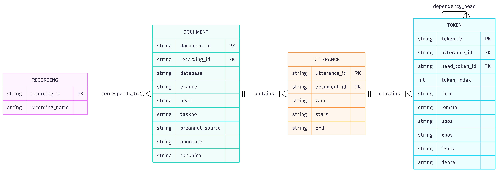

# Database of Spoken Czech as a Foreign Language (Citizenship in the Czech Republic): Technical Documentation

## a) Basic Information

**Result name:** Database of Spoken Czech as a Foreign Language (Citizenship in the Czech Republic)

**Result type:** S – specialized public database

**Result owner:** Charles University

**Database creator:** Institute of Formal and Applied Linguistics, Faculty of Mathematics and Physics, Charles University.

**Database users:** Educators and students, institutions involved in teaching Czech as a foreign language or administering Czech-as-a-foreign-language exams, other educational institutions, and the general public, especially those interested in Czech as a foreign language.

**Database location:** The database is integrated into the TEITOK system (<http://teitok.corpuswiki.org/>), which is operated on the LINDAT/CLARIAH-CZ platform (<https://lindat.cz/>).

**Public database address:** <http://hdl.handle.net/11346/H4WT>

## b) Purpose of the Result

The purpose of the database is to make available authentic spoken performances by non-native speakers of Czech at the B1 language level according to the Common European Framework of Reference for Languages (CEFR), which is required for obtaining citizenship in the Czech Republic. The database contains recordings of the oral part of the [Czech Language Certificate Exam](https://ujop.cuni.cz/cce) at the B1 level. The recordings include dialogues between the examiner (a native speaker) and the examination candidate (a non-native speaker). The recordings are accompanied by manual transcriptions and rich linguistic annotation.

The database was created as part of a project implemented at the Institute of Formal and Applied Linguistics of the Faculty of Mathematics and Physics, Charles University. Its creation builds on research conducted within the project. The following research and data-analysis activities were carried out in its preparation: collecting audio recordings; anonymizing them; researching spoken performances by non-native speakers of Czech from a linguistic perspective; researching methods for transcribing the collected performances; creating and revising manual transcriptions; identifying individual speakers (examiner vs. examination candidate); time-aligning transcriptions with recordings; automatic linguistic annotation; and preparing structured data for publication in the TEITOK environment.

Extent of work on the result: 0.8 FTE

**Further plans for the database:** The database is published as a specialized public database and is freely available to the general public. It is also intended as a dataset for developing software to automatically assess spoken performances by non-native speakers of Czech.

## c) Data Architecture

### Basic Description of the Database and Data Scope

The database contains audio recordings of the oral part of the Czech Language Certificate Exam at the B1 level and their manual transcriptions in TEITOK (XML) format. Individual TEITOK files are linked to the corresponding MP3 audio recordings.

The provider of the recordings (the Institute for Language and Preparatory Studies of Charles University, ILPS CU, <https://ujop.cuni.cz/UJOP-1.html>) permitted only selected tasks to be published. The database therefore contains only those parts of the recordings whose publication was permitted by the provider.

Each record contains the corresponding audio recording and its manual transcription. The transcriptions capture individual utterances, identify the speakers (examiner vs. examination candidate), and align them with the recording. They also include automatic linguistic annotation.

#### Database Scope

The basic database statistics are summarized below:

- Number of audio recordings: 65
- Total length of recordings in the database: 4h 51m 48s
- Number of files with manual transcriptions: 65
- Number of tokens: 29,572
- Number of utterances: 3,348
- Language: Czech
- Language level: B1 according to the CEFR

### Database Structure

The database consists of the following entities and relationships between them:

1. **Recording** – Represents the original audio recording. Each recording in the database has a manual transcription.
2. **Document** – Corresponds to an individual transcript in TEITOK (XML) format. It contains metadata about the exam and its transcription (CEFR level, exam ID, task number, transcription annotator code, etc.) and is linked to a recording.
3. **Utterance** – Individual utterances within a document. They contain information about the speaker (`who`) and timestamps (`start`, `end`).
4. **Token** – The basic unit of text (word form). Each token is specified by its textual realization (`form`), lemma (`lemma`), part-of-speech tags (`upos`, `xpos`), morphological features (`feats`), and syntactic dependency (`deprel`).
    - *Recursive relationship:* A token can refer to itself (`head`), forming a tree structure of dependency syntax.

**Graphical representation of the structure.** The following E-R diagram provides a more detailed representation of the database structure described above:

**Structure of TEITOK files.** The basic building blocks of the database are files representing transcripts in TEITOK format. TEITOK is an XML format that complies with the Text Encoding Initiative (TEI) standard (<https://www.tei-c.org/>), but uses a slightly different approach to tokenization. The structure of TEITOK files in our database is as follows:

**Header with metadata `<teiHeader>`.** The TEITOK file header consists of the following parts:

1. **`<fileDesc>` – File description**
    - **`<titleStmt>`:** Contains the title of the file and information about authors and annotators.
    - **`<editionStmt>`:** Contains the version number.
    - **`<publicationStmt>`:** Contains publication details such as the publisher, publication date, and license.
    - **`<sourceDesc>`:** Describes the source recording and links to it.
2. **`<encodingDesc>` – Description of encoding**
    - **`<projectDesc>`:** A brief description of the project in which the data was created.
    - **`<annotationDecl>`:** Details of the individual annotation steps (primary annotation, revision, and linguistic annotation).
3. **`<profileDesc>` – Profile of the text**
    - **`<langUsage>`:** Language used (Czech).
    - **`<textClass>`:** Document metadata:
      - `database`: Database name.
      - `exam-id`: Exam identifier.
      - `cefr-level`: CEFR level. This database contains recordings exclusively from B1-level exams.
      - `task-number`: Task number.
      - `preannot-source`: Source of preliminary transcription. Since all transcriptions in this database were created entirely by hand, this value is always `from_scratch`.
      - `annotator`: Annotator code.
      - `canonical`: A value of `1` indicates a canonical transcription. Since the database contains no duplicate transcriptions, every transcription is canonical.

**Main content `<text>`.** The `<text>` section contains individual segments of spoken speech structured using `<u>` elements:

- **`<u>`:** Each element represents a segment of speech and has the following attributes:
  - `start` and `end`: Start and end time in seconds.
  - `who`: Speaker (e.g., `EXAM_1` for the examiner and `CAND_1` for the candidate).
- **`<s>`:** Each sentence is marked with the `<s>` element.
- **`<tok>`:** Token elements whose attributes describe the lemma, part of speech, morphological features, and syntactic relationship.
- **`<anon/>`:** An anonymized segment of the recording.
- **`<gap reason="unintelligible"/>`:** An unintelligible segment of the recording.

**Token annotation in the `<tok>` element.** The `<tok>` element represents a token, which usually corresponds to a word. Each token is further described by the following attributes, corresponding to the standards of the [Universal Dependencies](https://universaldependencies.org/guidelines.html) project:

- **`ord`**: Ordinal number of the token in the sentence.
- **`lemma`**: Base form of the word.
- **`upos`**: Universal part-of-speech tag.
- **`xpos`**: Original morphological tag.
- **`feats`**: Morphological features.
- **`head`**: Reference to the parent token.
- **`deprel`**: Type of the syntactic dependency relation to the parent.

**Completeness of records and metadata.** Individual records contain the corresponding audio recording and its manual transcription. The transcriptions contain speaker identification (examiner vs. examination candidate) and timestamps for individual utterances. They also include automatic linguistic annotation. All records in the database contain this information.

The scope of the published recordings is determined by the consent of the data provider, which permitted only selected tasks to be published. The published recordings therefore do not necessarily contain the original recording of the entire exam.

## d) Working with the Data (Sorting, Filtering, Searching, etc.)

The database provides the following functions:

- Viewing audio recordings and their manual transcriptions.
- Displaying individual utterances and identifying speakers.
- Playing recordings and viewing synchronized transcriptions.
- Displaying the start and end timestamps of individual utterances.
- Displaying automatic linguistic annotation of individual tokens:
  - part of speech (PoS),
  - morphological tag,
  - detailed morphological features,
  - lemma (base form of the word).
- Displaying automatic syntactic analysis as a dependency tree.
- Searching using the CQL language.
- Creating search queries through the graphical Query Builder interface.
- Displaying search results in a clear format.
- Exporting search results in XML format.

A detailed guide to using the individual functions and examples of searches is provided in a separate user manual.

## e) Software Tools Used

The database is publicly available through the LINDAT/CLARIAH-CZ platform and the TEITOK system. Access is free and does not require registration.

The data comprising the database is also stored in the certified LINDAT/CLARIAH-CZ repository, which provides long-term preservation, regular backups, and a Handle-type persistent identifier. LINDAT/CLARIAH-CZ repository records are indexed by internet search engines (including Google), and the associated metadata are also made available in the CLARIN Virtual Language Observatory (VLO) catalog. The record can thus be found through a standard search. The dataset corresponding to this database is available at <http://hdl.handle.net/11234/1-6311>.

The LINDAT/CLARIAH-CZ repository does not currently assign DOI-type persistent identifiers. For this reason, a record for the database is also registered in the Data Catch-all Repository, which is not yet fully certified. The record is available at [https://doi.org/10.48700/hftww-b2k53](https://doi.org/10.48700/hftww-b2k53).

We used additional tools for preparing and processing the data and annotations, described below.

### TEITOK

[TEITOK](http://teitok.corpuswiki.org/) is a framework for creating, managing, and publishing annotated corpora. It enables the database to be managed, viewed, searched, and made accessible. Its web interface is implemented using a combination of PHP and JavaScript.

For our project, which combines recordings of spoken speech and their transcriptions, the key functionality of the TEITOK environment is the ability to create, display, and edit recordings' transcriptions (<http://www.teitok.org/index.php?action=help&id=wavesurfer>).

TEITOK uses the JavaScript library [WaveSurfer.js](http://wavesurfer-js.org/) to work with the recordings themselves.

**Data storage.** The corpus data is primarily stored in the TEITOK environment in the form of files. In this case, the recordings are in MP3 format, while the main components are TEITOK-format files containing all transcriptions and annotations, including metadata. These files are linked to the corresponding recordings.

In addition, the database data is stored in the certified LINDAT/CLARIAH-CZ repository (see below), which provides secure storage with regular backups and persistent identifiers.

**Querying, searching, and filtering.** Rapid querying, searching, and filtering are enabled by the integrated [CQP Query Processor](https://cwb.sourceforge.io/files/CQP_Manual.pdf), a key component of the [IMS Open Corpus Workbench (CWB)](https://cwb.sourceforge.io/) toolkit.

CQP converts XML-formatted corpora into binary format and efficiently indexes them.

Querying indexed corpora is performed using the [CQL](https://www.latl.leeds.ac.uk/wp-content/uploads/sites/49/2019/07/CQL-Help-1.3.pdf) language, which is a standard in corpus linguistics.

TEITOK also offers a Query Builder, in which users can specify a query by filling out a form. The query result returned by CQP is then processed using TEITOK and presented to the user in a clear format. Query results can be downloaded in XML format.

### LINDAT/CLARIAH-CZ Repository

In addition, the database data is stored in the certified LINDAT/CLARIAH-CZ repository (<https://lindat.mff.cuni.cz/repository/>), operated by the Institute of Formal and Applied Linguistics of the Faculty of Mathematics and Physics, Charles University. The repository is primarily part of the large LINDAT/CLARIAH-CZ research infrastructure and is also part of the National Repository Platform (NRP), the Czech implementation of the European Open Science Cloud (EOSC). It is based on CLARIN-DSpace software, one of the main systems further developed within the NRP. The repository is also part of the European CLARIN ERIC infrastructure.

The entire repository regularly undergoes CoreTrustSeal certification (<https://www.coretrustseal.org/>). The certification is based on a self-assessment subsequently evaluated by independent reviewers. The self-assessment also describes data storage, backups, and persistent identifiers. The currently valid assessment is available at <http://hdl.handle.net/11234/6-CTS>.

**Data storage and backup.** The repository provides long-term care for stored items and uses automated procedures, including integrity checks, to ensure data integrity and metadata completeness. Disaster recovery is handled by a multi-level backup scheme that includes a weekly backup to external hierarchical storage. Backups are performed automatically on separate servers, and both the hardware platform and service operation are monitored. Details are provided in the CoreTrustSeal document. It is the repository's policy not to delete deposited datasets.

**Protection of persistent identifiers.** Each item stored in the repository receives a Handle-type persistent identifier, registered in cooperation with the EPIC consortium. The Handle and its corresponding URL remain functional even if the repository's technical location or address changes.

LINDAT/CLARIAH-CZ does not currently assign DOI-type persistent identifiers. For this reason, the database record is also registered in the Data Catch-all Repository (see below).

**Indexing and searching.** The LINDAT/CLARIAH-CZ repository is based on DSpace 7 software, which [supports indexing](https://wiki.lyrasis.org/spaces/DSDOC7x/pages/104566800/Search+Engine+Optimization) content by web search engines, including Google and Google Scholar. The repository publishes XML and HTML sitemaps (`sitemap_index.xml`, `sitemap_index.html`), to which the `robots.txt` file points. The page for each item also contains metadata in Dublin Core format and `citation_*` tags recommended for Google Scholar. Publicly available items, including the data from the database described here, are therefore readily accessible to search engines, including through the persistent Handle link.

### Data Catch-all Repository

The database record is also registered in the [Data Catch-all Repository](https://datarepo.eosc.cz/), which is also part of the National Repository Platform (NRP). Unlike LINDAT/CLARIAH-CZ, this repository assigns DOI-type persistent identifiers. However, it is not yet fully certified.

### Preparation of TEITOK Files

The preparation of TEITOK files took place in several phases:

1. **Manual transcription.** All recordings were transcribed manually from scratch, without using outputs from automatic speech recognition systems. The transcriptions were created directly in TEITOK format, which allows utterances to be marked (the `<u>` elements), speakers to be identified (the `who` attribute), and utterances to be time-aligned with the recording (the `start` and `end` attributes).

Manual transcriptions of the recordings were prepared by trained annotators, who also anonymized them in accordance with the requirements of the Institute for Language and Preparatory Studies of Charles University (ILPS CU), which provided the audio recordings for the corpus. Some annotators also anonymized data as a precaution even when it did not need to be anonymized (e.g., fictitious names of people).

2. **Revision.** Manual review of the manual annotations by a co-author of the database.
3. **Normalization.** Automatic adjustment of the transcriptions that removes discrepancies in speaker names, orders utterances according to start time, and assigns new sequential IDs to utterances.
4. **Segmentation by Tasks and Selection.** The provider of the recordings (ILPS CU) permitted only selected tasks to be published. We had to cut these tasks from the recordings and adjust the timestamps in the transcriptions to preserve the alignment of the utterances in the transcription with the recording. We used the [FFmpeg](https://www.ffmpeg.org/) tool to cut the recordings.
5. **Linguistic annotation.** Up to this phase, the utterances in the transcriptions had not been further structured. In this phase, we divided the text into sentences (the `<s>` elements) and then into tokens (the `<tok>` elements). At the token level, the transcriptions were automatically linguistically annotated. Each token was assigned a lemma, part of speech, morphological features, and syntactic relations. We used the UDPipe 2 tool, specifically the `czech-pdt-ud-2.12-230717` model.
6. **Completion of the TEI header.** Finally, we completed the header using all available metadata so that it complied with TEI standards.

All tools and scripts (primarily in Python 3 and BASH) are available in the [public repository of the project](https://github.com/ufal/evaldio) in the `data_preparation` directory.

**Linguistic annotation.** The transcriptions contain automatic linguistic annotation including tokenization, lemmatization, morphological analysis, and dependency syntactic analysis.

For linguistic annotation, including tokenization, we used the [UDPipe 2](https://ufal.mff.cuni.cz/udpipe/2) tool, specifically the `czech-pdt-ud-2.12-230717` model for Czech.

Each token is assigned a lemma (the `lemma` attribute), a language-specific morphological tag (the `xpos` attribute), a part of speech, and morphological features according to the categorization of the [Universal Dependencies](https://universaldependencies.org/) project (the `upos` and `feats` attributes). In addition, each token is assigned a reference to its parent ID according to dependency syntax rules (the `head` attribute) and the type of the token's dependency relation to its parent (the `deprel` attribute).

Although tokenization and automatic linguistic annotation can be performed directly in the TEITOK environment, we carried out this process separately. The reason is that the tokenization method in the TEITOK environment differs from the method optimized for UDPipe, which could lead to errors when combining these two steps.

## f) Demonstration of the Novelty and Uniqueness of the Specialized Public Database

The database is a unique, previously unpublished linguistic resource: authentic audio recordings of oral exams in Czech as a foreign language at the B1 level, their manual transcriptions, identification of individual speakers (examiner vs. examination candidate), time alignment of utterances with the recordings, and automatic linguistic annotation.

The creation of the database was preceded by research focused on collecting and processing authentic spoken performances, comparing methods for transcribing spoken speech, manually annotating and revising transcriptions, and subsequently performing automatic linguistic annotation.

The database's specific contribution is the connection of the audio form of spoken performances with their structured textual transcriptions and detailed linguistic annotation. Timestamps for individual utterances enable precise linking of the text to the corresponding part of the recording. Automatic morphological and syntactic annotation facilitates searching for linguistic phenomena and using the database in teaching and studying Czech as a foreign language.

## How to Cite

Rysová Kateřina, Novák Michal, Rysová Magdaléna, Polák Peter, Bojar Ondřej: *Database of Spoken Czech as a Foreign Language (Citizenship in the Czech Republic)*. Institute of Formal and Applied Linguistics, Faculty of Mathematics and Physics, Charles University, Prague 2026. Available at <http://hdl.handle.net/11346/H4WT>.

## Dedication

The database was funded by the Programme to Support Applied Research in the Area of the National and Cultural Identity for the Years 2023 to 2030 (NAKI III) of the Ministry of Culture of the Czech Republic within the project *Automated Speech Scoring in Czech* (DH23P03OVV037).
